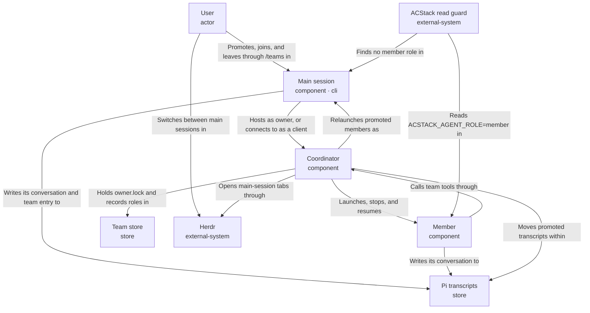

# Session roles - promotion, joining, and several main sessions

A team can have several main sessions. The user can promote a member into a main session or join an existing session to a team. Identity, transcript discovery, membership, coordinator ownership, and permission authority stay separate, and ACSTACK\_AGENT\_ROLE tells hooks which processes are main.

<!-- Generated from the entry YAML and its element files; regenerate with design-doc --markdown -->

## Session roles: promotion, joining, and several main sessions

Status: implemented. This document describes the session-role behavior introduced for [issue #19](https://github.com/ac8318740/ac-teams/issues/19). Current code lives in [`team/sessions.ts`](../../../src/team/sessions.ts), [`team/coordinator.ts`](../../../src/team/coordinator.ts), and [`extension/session.ts`](../../../src/extension/session.ts).

A team can have several **main sessions**. A main session is a Pi session the user created, joined to a team, or promoted. Every other team process is a **member**. The user can promote a member to a main session from the TUI, or join an existing session to a team with `/teams join`. ac-teams marks every member process with `ACSTACK_AGENT_ROLE=member`, so ACStack's large-read guard applies only to main sessions.

### Implemented trade-offs

- **Relaunch, not live handover.** Promotion stops the member process and reopens its transcript in a new process. The member loses its in-flight turn, but its role, sandbox, token, and environment change cleanly.
- **No coordinator daemon.** The coordinator stays inside whichever main session holds `owner.lock`. When the owner exits, members stop and the next owner resumes them automatically. The cost is a pause and at most one redone turn per busy member.
- **Wide main-session authority.** Any main session can stop work started by another. ac-teams does not try to guard against this, because an unsandboxed session can already stop processes through the shell or Herdr.

## Definitions

These five properties are recorded separately. Promotion changes discovery and authority without changing Pi session identity.

| Property | Defined by | Changes when |
|---|---|---|
| Identity | Pi session id in the transcript header | Never |
| Discovery | Where the transcript file lives | Promotion moves it to the top-level session folder |
| Membership | A member record in the team store | Join adds one; leave clears its role |
| Coordinator ownership | Holder of `owner.lock` | The owner exits and another main session takes it |
| Authority | The record's `role`: `main` or `member` | Only promotion, join, or leave, all user actions |

### What the coordinator does

The coordinator is ac-teams' in-process server, running inside whichever main session holds `owner.lock`. It:

- **Runs member processes.** Starts each member's Pi, either headless or in tmux, optionally inside a Docker sandbox. It also stops and resumes members, and stops them all when its host session exits
- **Answers team tools.** The owner calls it locally; clients send `team_agent`, `team_task`, and `team_message` calls over `coordinator.sock`. One coordinator applies all changes
- **Keeps team state.** Writes members, tasks, and messages to the team store
- **Delivers notifications.** Tells each session when new team messages arrive
- **Enforces rules.** Checks authority, depth and member limits, and sandbox grants, and brokers provider credentials for sandboxed members

Role checks also cover connections from main sessions the coordinator did not launch, promotion, joining, leaving, and ownership takeover.

The team id stays the session id of the session that created the team, even after that session leaves or hands over ownership.

### Main-agent signal

- The coordinator sets `ACSTACK_AGENT_ROLE=member` on every member process, next to `AC_TEAMS_MEMBER`, in both RPC and terminal launch paths
- A hook treats the session as main when the variable is absent or `main`, and as not main for any other value
- Anything a member starts inherits the variable and counts as not main
- Promotion and every main-session launch remove `ACSTACK_AGENT_ROLE`, every `AC_TEAMS_*` variable, and `HERDR_ENV=0` through `mainEnv` in [`members/main-terminal.ts`](../../../src/members/main-terminal.ts)
- ACStack reads the variable on every tool call. It detects Claude Code and Codex subagents from `agent_id` in their hook payloads instead. That detection belongs to ACStack, not ac-teams
- The environment signal grants no permission by itself; coordinator authority comes from the stored role

## User flows

### Promote a member

1. The user opens a teammate from the agent selector or `/teams` and chooses **Promote to main**
2. If the member is sandboxed, a confirmation states that the session will run with the user's full access. Declining cancels
3. The coordinator stops the member and waits for its process to exit
4. The coordinator moves the transcript from `ac-teams/<team>/<member>/` to the project's top-level session folder. It removes the member's config at `~/.pi/ac-teams/agents/<id>` and sets the member's role to `main` without a parent. The member's children stay its descendants
5. The coordinator writes the session's team entry: a Pi custom entry holding the team id and member id, with no secrets
6. The coordinator relaunches `pi --session <moved file>` with a clean environment:
    - With Herdr, in a new tab in the workspace for the session's worktree, creating the workspace if needed. The tab gets focus and the session's name
    - Without Herdr, in a tmux session on a per-main-session socket that the owner's `kill-server` cannot reach. The user's screen stays attached, and ac-teams prints the reattach command
7. The new process reads its team entry, connects to the coordinator with a main-session token from the team store, and appears in `/resume`

### Join an existing session to a team

1. The user runs `/teams join` in an ordinary Pi session
2. ac-teams lists this project's teams. The user picks one
3. ac-teams refuses if the session already belongs to a team with members, or if its session id is already in the chosen team
4. The coordinator adds a member record with role `main` and writes the team entry
5. The session receives a short summary of open tasks, owners, and recent messages, with its message cursor at the latest message. It claims or creates work with the normal team tools

### Several main sessions

- The owner hosts the coordinator in-process. Other main sessions each hold one authenticated connection over `coordinator.sock`
- Every main session sits at depth 0. Any main session can launch, stop, resume, and clean up any member, and stop or resume another main session
- Stopping a main session asks it to shut down through its connection. Resuming one relaunches its transcript, as in step 6 of promotion
- Members control only their descendants and never a main session
- Tasks and messages stay shared. Ownership and revision checks still serialize concurrent edits, because one coordinator applies them all

### Leave a team

`/teams leave` returns the session's in-progress tasks to todo and clears their ownership. The member record keeps its history but loses its role, so its descendants stay under the other main sessions. The team entry records the departure, so a later `/resume` does not rejoin. Leaving is refused while the session is the only main session and members are still live.

## Recovery

- **The owner exits while another main session runs.** Before stopping members, the owner records each one's state (busy, idle, or needs input) in the team store. A connected main session then takes `owner.lock`, opens the coordinator, and runs the resume pass below. Every main session gets a notice naming the new owner
- **No main session is running when the owner exits.** Members stay stopped with their recorded state. The next main session that opens the team runs the same resume pass
- **A promoted session is resumed with no coordinator running.** The extension reads its team entry at startup and offers to take ownership. Accepting opens the coordinator and runs the resume pass. Declining runs the session without team tools

### Resume pass

| Recorded state | Action |
|---|---|
| Busy | Resume and send: "Your process was restarted during a coordinator handover. Check your last steps and continue your current task." |
| Idle | Resume and leave idle |
| Needs input | Resume and show **Needs input** again |

Pi saves each completed message, so a busy member loses only the reply it was generating and redoes that turn. A command killed mid-run may have half finished. The message tells the member to check before it continues, which reduces that risk but does not remove it, the same as stopping a member today.
- **A main session crashes.** Its record stays. The coordinator marks it interrupted, and any main session can resume it
- **Promotion fails partway.** Each step is recorded in the team store before the next starts. On failure, the coordinator rolls back to a stopped member with its original transcript path, and the member can be retried or resumed

## Security boundaries

- Only the user can promote, join, or leave. These actions have no agent-tool form
- Promoting a sandboxed member is an explicit escalation, approved in the confirmation step. Without approval, nothing changes
- Main-session tokens live in the private team store, which sandboxed members cannot read. A member therefore cannot impersonate a main session over the socket
- Descendant non-escalation stays as it is: a member cannot grant its descendants more access than it has
- Provider credentials for sandboxed members come from the current owner's Pi login. After a takeover, the new owner brokers them under the same OS user

## Implementation boundaries

- **Team records.** Schema 4 introduced member roles and main-session tokens. [`team/snapshot.ts`](../../../src/team/snapshot.ts) now migrates schemas 1 through 4 to schema 5, retaining those roles
- **Coordination.** `team/sessions.ts` owns promotion, transcript moves, rollback, and main-session stop/resume. `team/coordinator.ts` owns handover recording and the resume pass. `team/protocol.ts` authenticates main-session clients
- **Pi integration.** `extension/session.ts` reads transcript team entries and owns joining, leaving, reconnecting, and takeover. `members/main-terminal.ts` launches main sessions through Herdr or tmux with a clean environment

## Regression coverage

[`coordinator.test.ts`](../../../test/coordinator.test.ts), [`extension.test.ts`](../../../test/extension.test.ts), and [`store.test.ts`](../../../test/store.test.ts) cover these behaviors; see [development checks](../../development.md#run-local-checks) for execution requirements.

- A launched member has `ACSTACK_AGENT_ROLE=member`, in both RPC and terminal modes
- A promoted session's environment has no `ACSTACK_AGENT_ROLE` and no `AC_TEAMS_*` variables
- Promotion keeps the session id, moves the file, updates the stored path, and writes the team entry. Pi's session listing then includes the session
- A sandboxed promotion is refused without confirmation and runs unsandboxed after it
- Joining refuses a duplicate session id, and refuses a session that leads another team with members
- A main session can stop and resume members and other main sessions. A member cannot act on a main session
- When the owner exits, another main session takes the lock. Busy members resume with the continue message, idle members stay idle, and members that needed input show **Needs input** again
- When no main session is running, the next one to open the team runs the same resume pass
- Resuming a promoted transcript with no coordinator offers takeover, and declining leaves team tools off
- Leaving returns in-progress tasks to todo and keeps descendants manageable
- A promotion interrupted after each step rolls back to a resumable member
- Legacy schema 3 teams migrate to schema 5 with root as a main record

## User

*Starts main sessions and is the only party who can promote a member, join a session to a team, or approve a sandboxed member's full access.*

- Identity: `user`
- Kind: actor
- Channels: none
- Source: [user.yaml](user.yaml)

## Main session

*A Pi session the user started, joined to a team, or promoted. Every main session controls every member and other main sessions, shares the team's tasks and messages, and belongs to one team at a time.*

- Identity: `main-session`
- Kind: component
- Channels: cli
- Source: [main-session.yaml](main-session.yaml)

## Main-agent signal

- Requirement: ACStack's large-read guard applies only to main agents. A main agent is a session the user created or promoted, never one an agent created. The signal must reach in-process Pi hooks and shell hooks, and must change when a member is promoted.
- Design response: The coordinator sets ACSTACK\_AGENT\_ROLE=member on every member process, next to AC\_TEAMS\_MEMBER. Absent or "main" means main; any other value means not main. Children of a member inherit it. Promotion always relaunches the transcript in a new process without ACSTACK\_AGENT\_ROLE or any AC\_TEAMS\_\* variable, so a live process never needs to change its role. Main status grants no permissions.
- Applies to: coordinator, member, main-session, read-guard

## Separate identity, discovery, membership, and authority

- Requirement: Issue \#19 forbids tying session identity or permission authority to picker visibility, storage location, or a single main session.
- Design response: Identity is the Pi session id. Discovery is where the transcript file lives. Membership and role are records in the team store. Ownership is whoever holds owner.lock. Authority comes from the member's role in the team store, which only explicit user actions change. Moving a file or taking the lock changes nothing else.
- Applies to: main-session, member, coordinator, team-store, transcripts

## Duplicate prevention

- Requirement: A session must not appear twice in a team, run as two processes, or belong to two teams.
- Design response: The team store keys members by member id and refuses a second record with the same Pi session id. The coordinator accepts one live connection per member and keeps the existing pid and identity check before any launch or relaunch. A session in a team with members cannot join another team.
- Applies to: coordinator, team-store, main-session

## Recovery without the original owner

- Requirement: The team must carry on when the owner exits, and a promoted session resumed later must find its team again.
- Design response: When the owner exits, another connected main session takes owner.lock and resumes members by their recorded state: busy members get a message to check their last steps and continue, idle members stay idle, and open questions reappear. A main session resumed from /resume reads its team entry, then connects to the live coordinator or offers to take ownership.
- Applies to: main-session, coordinator, team-store, member

## Member

*An agent-launched Pi process with ACSTACK\_AGENT\_ROLE=member and AC\_TEAMS\_\* variables. It controls only its descendants, and its transcript stays under ac-teams/&\#60;team&\#62;/&\#60;member&\#62;/ until promotion.*

- Identity: `member`
- Kind: component
- Channels: none
- Source: [member.yaml](member.yaml)

## Main-agent signal

- Requirement: ACStack's large-read guard applies only to main agents. A main agent is a session the user created or promoted, never one an agent created. The signal must reach in-process Pi hooks and shell hooks, and must change when a member is promoted.
- Design response: The coordinator sets ACSTACK\_AGENT\_ROLE=member on every member process, next to AC\_TEAMS\_MEMBER. Absent or "main" means main; any other value means not main. Children of a member inherit it. Promotion always relaunches the transcript in a new process without ACSTACK\_AGENT\_ROLE or any AC\_TEAMS\_\* variable, so a live process never needs to change its role. Main status grants no permissions.
- Applies to: coordinator, member, main-session, read-guard

## Separate identity, discovery, membership, and authority

- Requirement: Issue \#19 forbids tying session identity or permission authority to picker visibility, storage location, or a single main session.
- Design response: Identity is the Pi session id. Discovery is where the transcript file lives. Membership and role are records in the team store. Ownership is whoever holds owner.lock. Authority comes from the member's role in the team store, which only explicit user actions change. Moving a file or taking the lock changes nothing else.
- Applies to: main-session, member, coordinator, team-store, transcripts

## Recovery without the original owner

- Requirement: The team must carry on when the owner exits, and a promoted session resumed later must find its team again.
- Design response: When the owner exits, another connected main session takes owner.lock and resumes members by their recorded state: busy members get a message to check their last steps and continue, idle members stay idle, and open questions reappear. A main session resumed from /resume reads its team entry, then connects to the live coordinator or offers to take ownership.
- Applies to: main-session, coordinator, team-store, member

## Coordinator

*The team's single referee, running inside whichever main session holds owner.lock. It starts and stops member processes, answers every team\_agent, team\_task, and team\_message call, delivers message notifications, checks who may do what, and runs promotion, joining, and takeover.*

- Identity: `coordinator`
- Kind: component
- Channels: none
- Source: [coordinator.yaml](coordinator.yaml)

## Main-agent signal

- Requirement: ACStack's large-read guard applies only to main agents. A main agent is a session the user created or promoted, never one an agent created. The signal must reach in-process Pi hooks and shell hooks, and must change when a member is promoted.
- Design response: The coordinator sets ACSTACK\_AGENT\_ROLE=member on every member process, next to AC\_TEAMS\_MEMBER. Absent or "main" means main; any other value means not main. Children of a member inherit it. Promotion always relaunches the transcript in a new process without ACSTACK\_AGENT\_ROLE or any AC\_TEAMS\_\* variable, so a live process never needs to change its role. Main status grants no permissions.
- Applies to: coordinator, member, main-session, read-guard

## Separate identity, discovery, membership, and authority

- Requirement: Issue \#19 forbids tying session identity or permission authority to picker visibility, storage location, or a single main session.
- Design response: Identity is the Pi session id. Discovery is where the transcript file lives. Membership and role are records in the team store. Ownership is whoever holds owner.lock. Authority comes from the member's role in the team store, which only explicit user actions change. Moving a file or taking the lock changes nothing else.
- Applies to: main-session, member, coordinator, team-store, transcripts

## Duplicate prevention

- Requirement: A session must not appear twice in a team, run as two processes, or belong to two teams.
- Design response: The team store keys members by member id and refuses a second record with the same Pi session id. The coordinator accepts one live connection per member and keeps the existing pid and identity check before any launch or relaunch. A session in a team with members cannot join another team.
- Applies to: coordinator, team-store, main-session

## Recovery without the original owner

- Requirement: The team must carry on when the owner exits, and a promoted session resumed later must find its team again.
- Design response: When the owner exits, another connected main session takes owner.lock and resumes members by their recorded state: busy members get a message to check their last steps and continue, idle members stay idle, and open questions reappear. A main session resumed from /resume reads its team entry, then connects to the live coordinator or offers to take ownership.
- Applies to: main-session, coordinator, team-store, member

## Team store

*Private team state under \~/.pi/ac-teams/teams/&\#60;team&\#62;/: members with their role, tasks, messages, owner.lock, and each main session's connection token. Sandboxed members cannot read it.*

- Identity: `team-store`
- Kind: store
- Channels: none
- Source: [team-store.yaml](team-store.yaml)

## Separate identity, discovery, membership, and authority

- Requirement: Issue \#19 forbids tying session identity or permission authority to picker visibility, storage location, or a single main session.
- Design response: Identity is the Pi session id. Discovery is where the transcript file lives. Membership and role are records in the team store. Ownership is whoever holds owner.lock. Authority comes from the member's role in the team store, which only explicit user actions change. Moving a file or taking the lock changes nothing else.
- Applies to: main-session, member, coordinator, team-store, transcripts

## Duplicate prevention

- Requirement: A session must not appear twice in a team, run as two processes, or belong to two teams.
- Design response: The team store keys members by member id and refuses a second record with the same Pi session id. The coordinator accepts one live connection per member and keeps the existing pid and identity check before any launch or relaunch. A session in a team with members cannot join another team.
- Applies to: coordinator, team-store, main-session

## Recovery without the original owner

- Requirement: The team must carry on when the owner exits, and a promoted session resumed later must find its team again.
- Design response: When the owner exits, another connected main session takes owner.lock and resumes members by their recorded state: busy members get a message to check their last steps and continue, idle members stay idle, and open questions reappear. A main session resumed from /resume reads its team entry, then connects to the live coordinator or offers to take ownership.
- Applies to: main-session, coordinator, team-store, member

## Pi transcripts

*Standard Pi session files. Main sessions sit at the top level of the project's session folder, where /resume finds them. Members sit under ac-teams/&\#60;team&\#62;/&\#60;member&\#62;/, where only /teams finds them.*

- Identity: `transcripts`
- Kind: store
- Channels: none
- Source: [transcripts.yaml](transcripts.yaml)

## Separate identity, discovery, membership, and authority

- Requirement: Issue \#19 forbids tying session identity or permission authority to picker visibility, storage location, or a single main session.
- Design response: Identity is the Pi session id. Discovery is where the transcript file lives. Membership and role are records in the team store. Ownership is whoever holds owner.lock. Authority comes from the member's role in the team store, which only explicit user actions change. Moving a file or taking the lock changes nothing else.
- Applies to: main-session, member, coordinator, team-store, transcripts

## Herdr

*Optional terminal workspace manager. When present, each main session gets its own tab in the workspace for its worktree.*

- Identity: `herdr`
- Kind: external-system
- Channels: none
- Source: [herdr.yaml](herdr.yaml)

## ACStack read guard

*ACStack's large-read hook. It blocks a large untargeted read once in main agents only, and reads ACSTACK\_AGENT\_ROLE on every call to decide.*

- Identity: `read-guard`
- Kind: external-system
- Channels: none
- Source: [read-guard.yaml](read-guard.yaml)

## Main-agent signal

- Requirement: ACStack's large-read guard applies only to main agents. A main agent is a session the user created or promoted, never one an agent created. The signal must reach in-process Pi hooks and shell hooks, and must change when a member is promoted.
- Design response: The coordinator sets ACSTACK\_AGENT\_ROLE=member on every member process, next to AC\_TEAMS\_MEMBER. Absent or "main" means main; any other value means not main. Children of a member inherit it. Promotion always relaunches the transcript in a new process without ACSTACK\_AGENT\_ROLE or any AC\_TEAMS\_\* variable, so a live process never needs to change its role. Main status grants no permissions.
- Applies to: coordinator, member, main-session, read-guard
